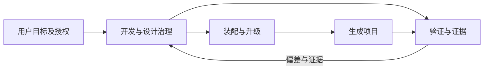

# VibeCodingRepoTemplate 系统总体设计

> 目标基线：同域长期设计持续有效；用户已批准落地，并要求同时支持新仓和存量整改。实现事实：完成保护、存量认领/升级、受管资产GC、证据导出、前台周期入口及CI/OS配置生成已实现并通过最终本地验证/独立审阅；具体证据见交接。配置生成不证明OS/云平台实际启用，也未证明中大型项目长期效果。

## 1. 目标与非目标

本仓交付可组合模板与Agent技能，使项目按稳定功能域持续维护设计，规范、实现、验证和知识回刷形成闭环。目标是生成可供AI Agent长期维护中大型软件的工程仓：既维护设计、源码、契约、测试与必要交付资产，也维护临时脚本、截图、日志和报告的归属、保留、转正及回收。保护用户现场，保留多语言/命名/角色能力，提供实际可运行的开发/验证/维护入口。

不提供业务后端、数据库、算子逻辑、Agent平台服务、扫描服务或自动发布系统；不以机器状态代替设计判断，不在未授权时提交/发布/清场。

## 2. 关键使用场景

- 新仓录取后得到政策入口、系统设计骨架、域索引与完整模板；识别实际功能域后开始规格化，不强塞治理业务域。
- 既有域第二次/第三次变化修订同一spec；跨域变化同时考虑公共不变量和专门契约owner。
- 无外部方法技能的环境执行同等仓内规范步骤；已安装的工具按共享产物契约调用，报告实际使用边界。
- 中断后用正式设计和短交接恢复当前目标、未完成条件；本地执行稿缺失不等于设计丢失。
- 已有仓先plan/check再apply，保留用户手改与历史，不静默覆盖。
- 多轮工作及会话中断后仍能定位有效设计、未完成事项和必要证据；临时资产可在受管策略下周期回收，正式基准和未知历史得到保护。

## 3. 系统边界与域

| 域 | 长期职责 | 权威 |
|---|---|---|
| 装配与升级 | 配置求解、新仓装配/存量认领、文件归属、路径安全、兼容及显式升级 | [001](../../specs/001-repo-assembly/spec.md) |
| 开发与设计治理 | 政策/设计层次、e2e方法编排、域演进、工程资产生命周期和续接 | [002](../../specs/002-development-governance/spec.md) |
| 验证与证据 | 可机查约束、检查执行、行为/语义证据分界、收敛与完成保护 | [003](../../specs/003-verification/spec.md) |

## 4. 公共不变量

- SYS-I1：AGENTS是政策/设计地图；宪法/rules定义约束；系统和域设计解释批准目标；配置仅定位与执行，不成为设计正文。
- SYS-I2：域身份和一次变化分开，同域修订同一权威；共享数据/契约字段不可双写，跨域变化只有一处公共语义。
- SYS-I3：提议、批准目标、当前实现/验证分开；不能把不符合设计的实现刷成正确，不能以测试绿覆盖语义冲突。
- SYS-I4：安全装配/升级不覆盖手改，不跟随输出symlink；外部动作不因工具可用或验收通过自动获授权。
- SYS-I5：重型过程稿默认不跟随日常提交增长；长期结论归正式owner，续接不依赖旧聊天。临时资产须有生命周期，受控GC保护活跃工作、未闭环和保留期内的必要证据；未知或未认领资产不因ignore或文件年龄而删除。
- SYS-I6：模板、方法说明、机查和自身设计共同维护；所有验证报告限定实际范围。

## 5. 核心协作与失败路径

新仓路径：录取→装配预检→骨架→e2e定位实际域→规格/方案批准→同域实现→分层验证→收敛回刷→短交接。

日常路径：先定位系统与所属域→明确本次差异及不变量→方法链共用执行稿→发现设计不成立返回裁决→更新原权威/事实资产并解释遗留。不能先建UUID再任意拼字段作为设计来源。

装配冲突在写入前拒绝；升级计划后或替换期间变化停止并保留竞争方内容/备份。缺工具/输入/真实环境报告blocked；检查执行失败是fail；语义待裁决是评审阻断。当前普通文件系统不提供全仓原子CAS，升级需独占编辑窗口。

## 6. 数据、接口和部署

本仓核心无业务数据库/API。配置/schema、模板Map、检查报告与本地任务状态是工具数据，其接口分别由三个域说明。生成项目的数据/契约owner由项目自身声明，不能继承AWB业务字段。

维护环境Node>=22；核心仅标准库。本地验证不安装依赖、不写Git、不部署。外部栈/Agent/OS可用性单独验收，不从静态适配文件推断实际支持。

## 7. 质量属性与演进

可维护性优先以同域多轮、跨域和无本地草稿恢复验证；安全性用非法路径/手改/中途变化负例；可移植性按平台列实测；兼容性保留v1资产和golden，不批量重写期望。

开箱能力分别报告已装配、实际可开发和指定版本可交付的证据，不能由骨架存在推断业务和部署已验证。clean包含版本收录、受管工作区增长、当前知识一致及证据可用，不要求工作中git status为空。周期维护区分策略配置、调度启用及真实运行；同一已启用策略内不逐次重复请批，新增范围按实际授权处理。

新能力先证明真实场景和唯一owner，不为状态机补更多字段/服务。历史整理须给映射并获授权；新仓布局可重新分层，但已有仓不能在新旧路径同时保留两套权威正文。

## 8. 重要决策

| 来源 | 决策 | 状态 |
|---|---|---|
| 本会话Astra整体重审及用户批准 | 文档/设计治理是中心，既有工具降回支撑；以连续演进而非工具计数验收 | 生效；C01–C09已修复，连续样本与分项独立审阅通过 |
| 用户初始约束 | 不复制AWB业务、不新增平台/扫描服务，不提交/发布/清场 | 生效 |
| 源事实与本机核对 | 源Spec Kit命令实现未vendoring，本机未发现安装；保留真实方法路由与同等替代，不假称调用 | 生效，真实Spec Kit集成待有工具环境验证 |
| 用户明确长期/临时工程资产及GC目标 | 临时资产纳入持续维护；在受管策略内自动回收，保持必要证据与恢复能力 | 已实现受管生命周期、GC及前台周期调用；OS配置生成已验证，实际调度安装及跨平台运行待验证 |

## 9. 当前差距与证据

既有同域三轮、跨域语义冲突、共享快照恢复和方法应用提供局部证据；程序化阶段字段不代表真实技能调用。专项审核曾在156项通过时发现C01–C09，本轮已用新增反例修复；分项/整体审阅进一步补了执行输入、目录输入、升级合并、Python实际文件选择、受管输入租约/引用及证据保留缺口。最终251项回归及独立限定复审通过。不能从用例计数推断目标充分。macOS/Git Bash/WSL、真实Agent自动加载、真实Spec Kit命令、外部部署及成熟仓长期演进仍缺完整实证。

深化研究进一步界定了后续问题：权威应针对语义、适用范围和版本，文件落点不能替代维护责任；当前知识、历史决策与执行材料需要不同更新方式；可执行架构/契约约束与内容审阅各有证据边界。上述为研究判断和候选方向，002记录生命周期/来源问题，003记录验证与试点问题，001已有成熟仓认领/升级开放项。模型更强或流程更多均不构成有效性证明，后续方案需用真实变化和固定质量约束比较。

runner报告现在自动登记为受管run，完成凭据保护、旧运行保护释放、内容核验导出、引用传递、隔离/恢复和周期调用已实际验证；证据仍按local-only/local-copy如实标记，实际传递另核。Linux前台周期已执行，systemd文件通过本机解析器检查；OS调度器未安装、其他OS与远端CI未执行。worktree cleanup仍仅预览，未知历史不进入GC。

普通存量仓通过adopt inspect/plan/check/apply显式认领已有设计、模块cwd和检查，批量清单可逐仓消费；项目正文/配置与工具分开管理，升级三方合并保留用户修改/删除并接受明确新配置。真实技能试用验证了既有仓保留、业务检查、截图/脚本/报告承接恢复和升级。apply成功只证明接线，未填项目内容仍会被验收阻断。
